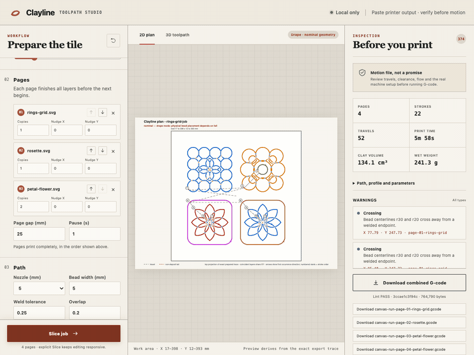
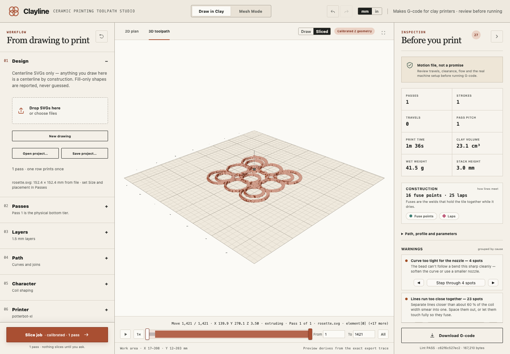
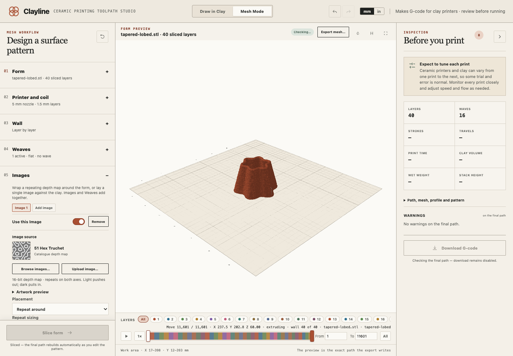
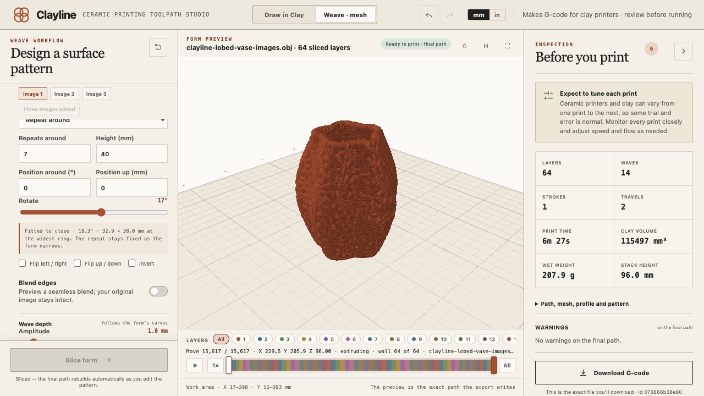
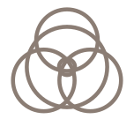
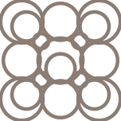
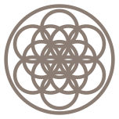
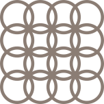
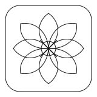
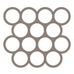

{ .cl-hero-mark alt="" }

# Clayline Toolpath Studio

Drawings and 3D models in. Print files for clay paste printers out.

[Download for Mac](https://github.com/peterkatz/clayline/releases/latest){ .md-button .md-button--primary }
[Read the guide](install.md){ .cl-quiet }

For Apple silicon Macs running macOS 14 or later. Free and open source.

<figure class="cl-demo" markdown>

<figcaption>A drawing on the bed, and the path the nozzle will follow through it.</figcaption>
</figure>

## Two ways to work

### Draw in Clay

Draw directly on the bed, bring a line drawing from any vector app as an SVG, or start from the 98 drawings in the gallery. Shape curves, mirror and repeat a motif, fill closed areas with coil, or trace over a reference photo. Repeat the design in ordered passes to build a tile, or let the coil drape from a raised nozzle for open lacework.

### Weave · mesh

Open a 3D model and shape its wall with up to three Weaves and three Images together. Draw a wave for ribs and spirals, wrap one of 80 relief tiles around the form, or place your own image as a single stamp. Adjust depth and clay flow independently, choose a hollow, solid or ribbed interior, and inspect the resulting nozzle path.

Both modes show the nozzle path in 2D and 3D, with a move-by-move scrubber and a **Before you print** panel for print time, clay use, travels and warnings. The preview comes from the same trace as the exported G-code.

## What you can make

| You want to… | What Clayline gives you |
|---|---|
| Draw a tile, ornament or open lacework | A drawing surface with editable lines and curves, shapes, mirroring, repeats, photo references and 98 gallery drawings. [Draw in Clay](tiles.md) |
| Build height from a drawing | Ordered, repeatable passes, filled areas, conventional layer heights or raised-nozzle drape settings. [Passes and layers](tiles.md#02-passes) |
| Shape the surface of a vessel | Three independent Weaves: editable waveforms, ribs, spirals, Noise and textures traced from real prints. [Pattern controls](weave.md#04-pattern) |
| Put a motif or an all-over relief on a form | Three Images with 80 catalogue depth maps, including 20 paisleys, plus grayscale and color uploads. Repeat around the wall or place a single stamp, then move, resize, rotate, flip or invert it. [Images](weave.md#05-images) |
| Control the wall and its interior | Depth and clay flow, skips and fades for each effect; spiral Vase mode; hollow walls, solid fill or sparse ribs, with floors and roof skins where needed. [Mesh workflow](weave.md#the-workflow-top-to-bottom) |
| Keep working on a design later | Portable projects include the drawings or model, settings and uploaded artwork. Save a surface pattern separately to use it on another form, or export G-code and the sliced coils as an OBJ. [Saving your work](weave.md#saving-your-project) |

## Images that follow the wall

A repeating Image keeps its repeat count as the form narrows or widens. Turn the whole design and Clayline fits an angle and spacing that close around the wall, showing the applied values beside the controls. A single stamp follows the surface in millimeters and can move across the wrap in one piece. Both stay attached to the original form when the nozzle's print start changes.

Middle gray preserves the wall, light pushes it out and dark pulls it in. Each Image has the same depth, clay-flow and skip-layer controls as a Weave. **Fade in** and **Fade out** ease both its relief and its clay changes together. Use them on Weaves too.

<figure class="cl-demo" markdown>

<figcaption>A toolpath preview on a tapered, lobed form. Here a requested 17° rotation fits to 18.3° so the repeating field closes around the wall.</figcaption>
</figure>

## Start from a drawing

Six of the 98 drawings that come with the app. Open one, redraw it, or bring your own.

## Where to start

- [Install](install.md): get the app running and pick your printer.
- [Draw in Clay](tiles.md): from a line drawing to a printed tile.
- [Weave · mesh](weave.md): from a 3D model to wave patterns, image relief and a printable wall.
- [Printing](printing.md): what the printer does with the file, and the three settings that decide how the first layer lands.
- [Troubleshooting](troubleshooting.md): the first layer scraped, the start blob is huge, the model loads sideways.

## Questions

Stuck, or wondering whether Clayline can do something? Ask under [Questions](https://github.com/peterkatz/clayline/discussions/categories/q-a) on Clayline's GitHub page; you'll get an answer there, and so will the next person who wonders the same thing. A file that won't slice or a print that went wrong goes under [Issues](https://github.com/peterkatz/clayline/issues) instead, with the drawing or model and the settings you used.

## Built for real printing

Clayline was built around a PotterBot 10 XL and shaped by real prints. Everything runs on your Mac: no account, no cloud, no internet connection needed. Nothing ever prints from the app itself. It writes a file, you look it over, and you take it to the printer.

!!! warning "Printer files move real machinery"
    Clayline checks every file against the printer's limits, not against your actual printer, clay, nozzle, or the space around it. Look the file over, keep the emergency stop within reach, and stay with the printer. Read [Safety](safety.md) before your first run.
