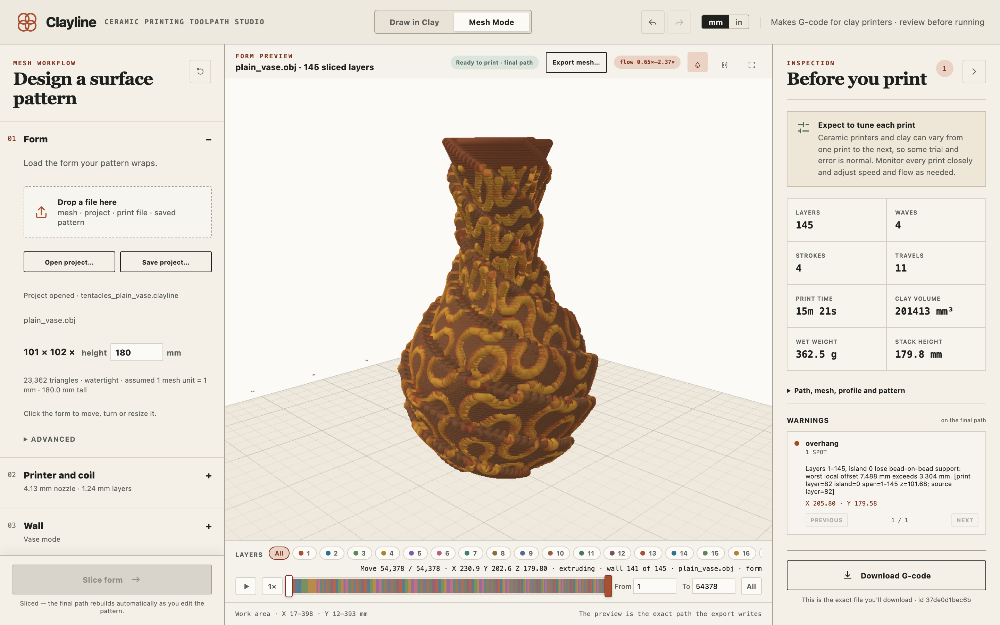
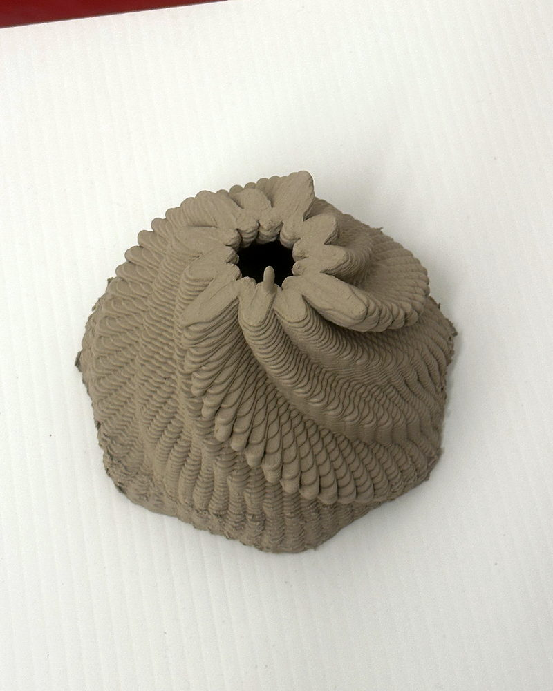
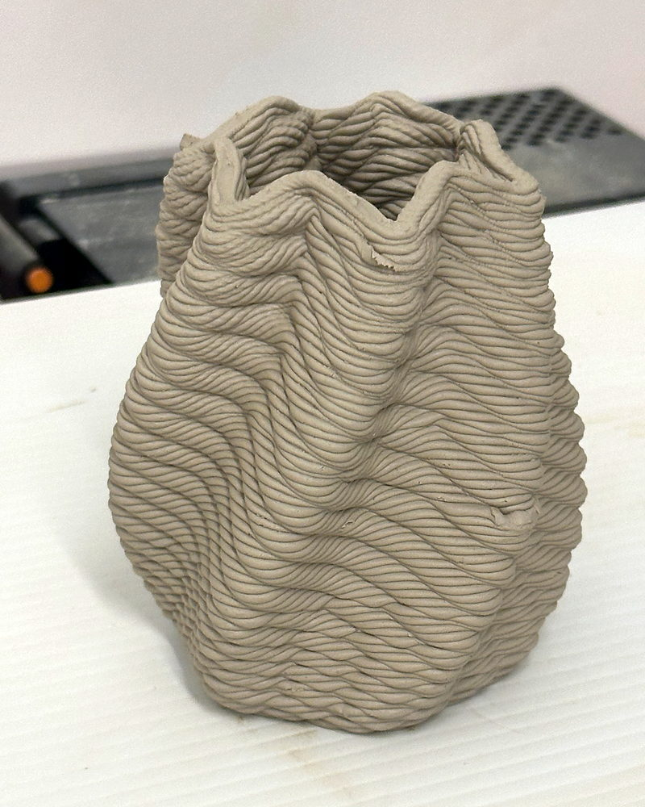
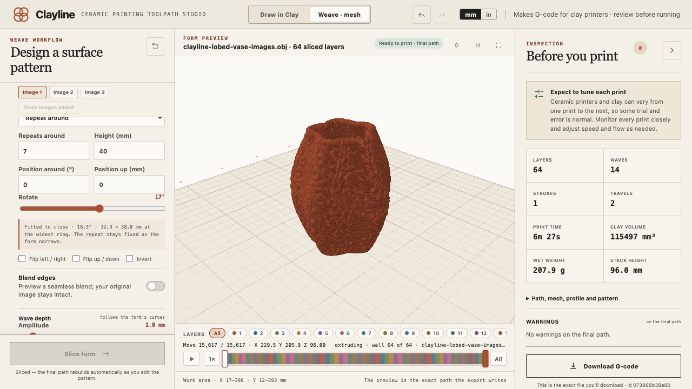
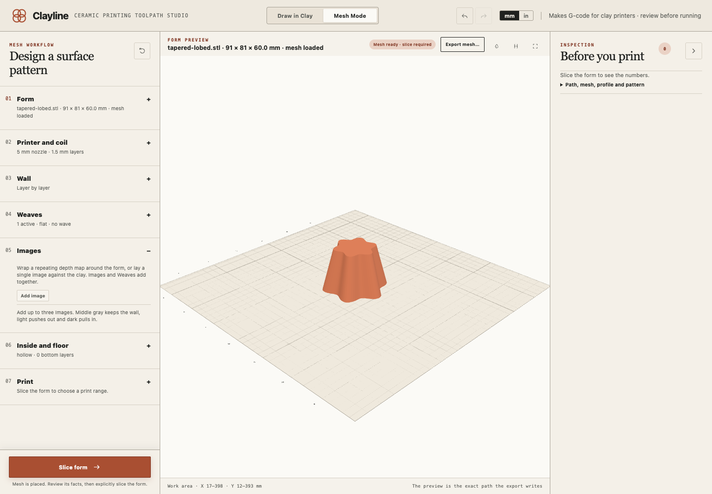
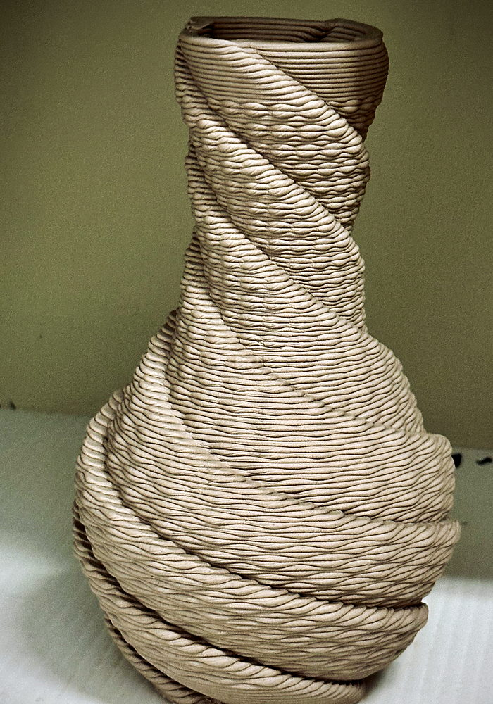
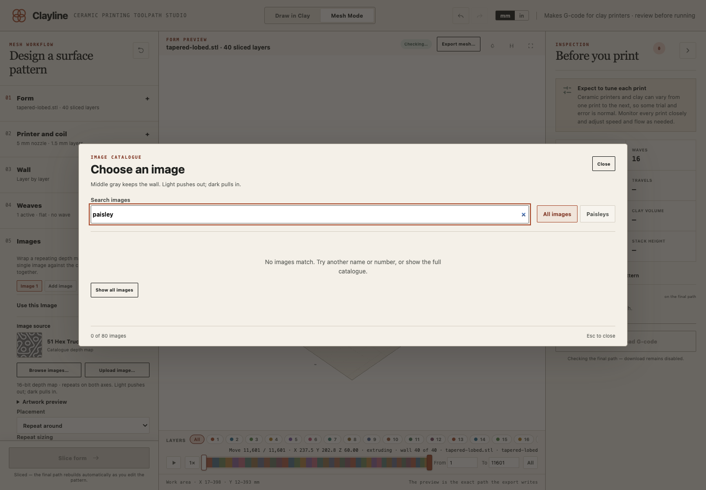

# Mesh Mode {#mesh-mode}

Shape a vessel from a 3D model, with wave patterns and image relief in its wall. Switch to **Mesh Mode** at the top of the window. Up to three Weaves and three Images work together on the same exterior; each keeps its own depth, clay flow and layer settings.

## What Mesh Mode does

Clayline cuts the model into horizontal rings, one per layer, then builds a nozzle path along them. A Weave moves that path in and out of the original surface according to a wave you shape. Stack the wave's crests and you get vertical ribs. Offset them by half a wave each layer and the wall weaves. Turn them a little each layer and the pattern spirals up the pot. An Image uses the lightness of a depth map or picture to raise and recess the wall instead.

<figure markdown>

<figcaption>Crests turned a little each layer: a spiral climbing the pot.</figcaption>
</figure>

<figure markdown>

<figcaption>Crests offset from one layer to the next: the wall weaves.</figcaption>
</figure>

Once the form is sliced, changing a Weave or Image rebuilds the final path in front of you. Choose discrete layers or a continuously rising Vase path, then a hollow, solid or ribbed interior as the form allows.

This toolpath preview uses Hex Truchet on a tapered, lobed form. A requested
40 mm Pattern size fits to 39.58 × 39.58 mm at the widest ring; the requested
17° rotation fits to 15.9°. The inline readout reports what the path uses.

## Using the controls

Click a numbered section header to open or close its accordion. Form starts open;
Weaves and Images can stay open together. Closing a section keeps every setting
and effect active. Open panels are remembered locally for each mode, outside your
project and Undo history. **Clay flow** and **Layer rhythm** group secondary effect
settings. Slice and preview remain available with every section closed.

The number beside a settings slider is editable: click or tab to it, type a
precise value, and press Enter or leave the field to apply it. Escape cancels an
unfinished edit. Invalid values show the allowed range and keep the last valid
setting. One completed edit takes one Undo. Dimensions use your chosen mm/in unit;
Twist is typed in cycles with degrees alongside.

## The workflow, top to bottom

### 01 Form

Drop a mesh file on the box: STL, OBJ, PLY, or 3MF, in millimetres. The same box also takes a saved project, a saved pattern, or a print file; what each brings back is below.

**Lay flat…**, beside the model's name, sets any surface of the form on the bed. Press it and the print path steps aside. Turn the view until you can see the surface, and rest the pointer on it: the connected flat area lights up. Click to lay it down, or press Esc to leave everything as it was. The form keeps its size, and Undo puts it back. Clicking the top turns the form over, because that is what you asked for.

When the base isn't sitting flat, a line under the name says so: "Base is tilted 3.0° — one side lifts 4.2 mm." **Flatten base**, beside that line, sets the nearest flat base down without turning the form over. If there is no flat base within 30° of the bottom, the line sends you to Lay flat. If the form only touches the bed at a small spot, under four coil widths across, the line warns that its first ring may not hold.

**Remove**, beside the model's name, takes it off the bed. Your settings stay as they are, except its rotations, nudges and stretches, so the next model doesn't arrive tilted. Undo brings the model back, placed as it was.

The size line shows the model's footprint and height. Type a height there to scale the whole form to an exact size. Under it, Clayline reports the triangle count, whether the form is watertight or has holes, and the unit it assumed. A model that comes in suspiciously small gets a note asking whether it was modelled in inches, with a one-click fix that scales it by 25.4.

Click the form in the preview to move, turn or resize it: drag the form to slide it, a ring to rotate it, the corner cube to resize it. Empty space orbits the view. The exact numbers live under **Advanced**: a size multiplier, **Width ×**, **Depth ×** and **Height ×** to stretch the placed form along the bed's own axes on top of that, nudges along X and Y, rotations about each axis, and **Reset placement** to go back to the file's own position. A stretch is real geometry: the sliced rings stretch with it, and the size line shows the result. With a height typed on the size line, though, that height wins: Height × then resizes the footprint needed to reach it rather than the height itself.

**Up axis**, under **Advanced**, says which way is up in the file. Rhino exports are usually Y up. If the sliced rings look like a tangled contour map instead of stacked walls, flip this.

The Form box also takes print files. One Clayline saved brings back every setting of that job, and with no model loaded, the form too: Clayline makes it from the print file's printed surface, pattern and all, at the size and angle it printed, so Scale reads 1 and nothing is turned, and switches every weave off so the pattern isn't laid on twice. That form holds only the layers that printed, so to change its size or layer height, work from the original model: the button under the form's name swaps it in, placed as it printed, with the weaves back on. A print made with Stack pieces, one whose form splits or joins up the way, and often one woven in vase mode give no form; for those, the middle of the window names the model the print file was sliced from, with a button to choose it. One from another slicer is read move by move: each layer's outer wall becomes a ring, the rings become a surface, and that surface loads like any model, at the file's own layer height and with the pattern set plain, because the file's texture is already in it. Fill lines, extra perimeters and a skirt are left out and counted, and the Form section says what was assumed.

### 02 Printer and coil

**Printer**, **Clay flow** and **Start charge** work exactly as in Draw in Clay. See [Printing](printing.md). **Keep clay flowing on crossings**, right under Start charge and on by default, keeps the printer pushing clay at the print rate while the nozzle lifts, crosses and comes back down, so the next line starts at full pressure instead of thin. It lays a little clay along each crossing; switch it off to stop the push on every crossing.

| Setting | What it does |
|---|---|
| **Nozzle opening** | The nozzle you fitted. Coil width and layer height follow it until you type your own. |
| **Layer height** | Starts at 30% of the nozzle. Type a value to take over; click **AUTO** to follow the nozzle again. |
| **First layer height** | The nozzle height for the first layer, which sets how hard the first coil is pressed onto the bed. |
| **Coil width** (Advanced) | Follows the nozzle. A sensible range is about 0.8 to 1.5 times the nozzle opening. Enter a measured width from a test line. |

### 03 Wall

**Vase mode · spiral rise** makes the wall climb in one continuous coil with no layer seams at all. With it on, two more choices appear. **Z-blend** lets the coil follow an uneven rim, climbing from flat lower rows to one continuous top path; any part of the rim the clay can't reach stays visible as a faded ghost and is never printed. **Finish with a level rim** ends the print on one flat revolution with the wave fading out, instead of following the top.

**Layer seam** chooses where each layer starts. **Chained** follows the nearest seam from layer to layer; **Scatter** spreads the starts around the form; **Pinned** holds them at one angle you set.

### 04 Weaves {#04-pattern}

**Weave 1**, at the top of the section, is the pattern you shape below. **Add weave** lays another weave over it with its own shape, amplitude, wavelength, twist, extrusion track, wave depth, Clay along the wall, skip layers and fades, so a long slow wave can carry a fine one; a wall takes up to three. Click a weave's name and the controls below show that weave. **Use this weave** leaves a weave out of the print but keeps its settings, so you can compare the wall with it and without it. Weaves 2 and 3 have **Remove**; Weave 1 can only be switched off. The Pattern preview shows every weave together. Each ring holds a whole number of every weave's waves, so on a taper a long weave's count steps where the form narrows, and with more than one weave the line under Wavelength names those layers. Each weave has its own **Keep the same number of waves**, off until you switch it on: it stacks that weave's ridges up a taper instead of stepping, and its waves sit closer together where the form narrows.

**Invert wave** exchanges ridges and grooves in the same position. **Reverse wave** reads each repeat backwards around the wall; the nozzle keeps its direction. Each action changes only the selected Weave and takes one Undo. Named Ridge/Trough boosts follow their named feature, while a hand-drawn clay track stays where you put it.

The wave editor shows one wave, with a faded repeat either side so you can see how its ends meet round the wall. Drag a point to reshape the wave, click empty space to add a point, right-click a point to remove it.

**Presets** give you a starting wave: Flat, Sine, Triangle, Saw, Rounded, Pulse, or Noise, with **New noise** dealing a fresh random variation of the noise.

**Textures** give the weave you are on a wave traced from a real print, for shapes the presets can't draw. **Rib** stacks crests that drift slowly around the wall. **Spiral** leans each ring's crests on the one below so the texture climbs in a continuous twist. **Edge** gives a crisp crest with a soft back. **Edge Boost** swells that crest on the form's lobes and settles it in the coves. On Weave 1 a texture sets the whole wall as it always has, vase mode, the level rim and Weave 1's Clay along the wall included; on Weave 2 or 3 it brings only the wave, with its amplitude, wavelength, twist, extrusion track and wave depth, and the wall and that weave's Clay along the wall stay as they were. Either way the other weaves stay, and your flow, speed, and nozzle stay yours.

| Setting | What it does |
|---|---|
| **Amplitude** | How far the wall moves in and out from the original form, in millimetres. |
| **Wavelength** | Crest-to-crest spacing in millimetres. Auto makes it 3.5 coils. Each closed ring rounds to a whole number of waves so the seam closes; the line under it says how many fit the widest ring. **Keep the same number of waves**, just above that line, keeps that count all the way up each part of the form. |
| **Twist** | How many wave cycles the pattern turns between one layer and the next. |
| **Ribs · 0**, **Stagger · 0.5**, **Spiral · +0.1** | Three presets for Twist: crests stacked into ribs, staggered like bricks, or turned gradually into a rising spiral. |

<figure class="cl-photo cl-photo--tall" markdown>

<figcaption>A long, slow wave spiralling up a bottle, with a fine staggered wave underneath it.</figcaption>
</figure>

**Pattern preview** shows the pot's wall unrolled flat like a fabric swatch, several layers side by side, so you can see ribs lining up, crests staggering, or the pattern drifting where the wave count changes on a taper. **Expand** opens it large.

**Wave depth** follows the form's own curvature: it makes the wave shallower or deeper on outward lobes and in inward coves. **Clay along the wall**, below it, pushes less or more clay on lobes and in coves, and works even with a flat wave. Each weave has its own, like its wave depth: the sliders show the Clay along the wall of the weave you are on and change only that weave. Every weave's follows the form's own lobes and coves, not its wave, and scales that weave's own extrusion track, and the weaves' add up, so on a Flat track the same setting adds the same clay whichever weave it is on. A texture chosen on Weave 1 sets Weave 1's back to even along with the rest of the wall. It counts as part of its weave's clay, so it pauses on that weave's plain layers when the weave skips layers. A weave switched off, Weave 1 included, leaves its Clay along the wall out of the print with the rest of it.

**Extrusion track** varies how much clay flows around each wave. Flat keeps it even. **Ridge boost** swells the crests; **Trough boost** swells the valleys so they round into soft beads instead of creases. **Phase** shifts where the swell lands.

**Skip layers** leaves the weave you are on off some layers without restarting it, the other effects carrying on: a number of plain layers to start, then how many layers the pattern is on and off, then plain layers to end. **Fade in** and **Fade out**, just below those controls, soften the relief and clay changes at each active run's ends. With Skip layers off, they fade the start and end of the wall. Zero gives an immediate switch.

Three buttons sit near the end of the section. **Save pattern** writes every Weave and Image to a file, including uploaded artwork, extrusion curves, skips and fades, along with this section's other settings except Pattern smoothness. **Load pattern** brings one back onto whatever form is on the table, replacing the Weaves and Images you had; Undo brings yours back. The form, its size and its settings stay as they are. **Restore pattern from G-code…** pulls the saved pattern out of a print file Clayline wrote: only the pattern comes across, not the model, the size, the layers, or the range. Dropping a print file Clayline saved on the box under 01 Form instead brings back every setting of that job, and with no model loaded, the form too when Clayline can make it.

**Pattern smoothness**, under **Advanced**, sets how finely the line follows the wave. Auto keeps it at half the coil width. Finer means smoother waves and heavier files. Changing it means slicing the form again.

### 05 Images

**Images** adds up to three independent relief maps alongside the three Weaves.
Choose from **80 catalogue tiles**: soft relief fields, Truchet ribbons, botanical
forms, drawn motifs and 20 paisley designs numbered 61–80. You can also upload
a grayscale or color image. Middle gray preserves the original wall, lighter tones push outward, and darker tones pull
inward. Transparent areas leave both the wall and clay flow unchanged. Catalogue
relief uses the original 16-bit maps; the small previews are for browsing.

Click **Add image** to create an Image, then choose **Browse images…** for the
thumbnail gallery or **Upload image…** for your own artwork. The gallery shows
each design's number and name; search either, or use **Paisleys** to see that
set together. Choosing a design keeps the Image's placement, depth, clay flow,
and other settings. Click an Image tab to edit it. **Use this Image** switches
its contribution off while keeping its settings; **Remove** takes it out, and
Undo brings it back. Three Images can sit alongside the three Weaves.

**Upload image…** takes a PNG, JPEG, TIFF, WebP, BMP, HEIC or Photoshop file, up
to 17 MB and 16 million pixels. From a Photoshop file Clayline reads the flattened
picture, so save it with **Maximize Compatibility** on. A 16-bit Photoshop file
won't open; save it at 8 bits per channel, or as a TIFF, which keeps a grayscale
image's full 16 bits.

**Repeat around** defaults new Images to **Pattern size · Keep proportions**.
Pattern size is the target width of one copy at the widest reference ring.
Clayline chooses a whole number of copies and preserves the artwork’s proportions;
the readout shows the fitted width × height, copies, angle and reference ring.
For example, a 50 mm square on a 240 mm wall fits as five 48 × 48 mm copies.
Bigger sizes produce fewer, larger copies in steps. Narrower parts of a form
compress the wrap, while the same count continues all the way around.

Choose **Set repeats & height** when you want to stretch artwork deliberately.
**Copies around** sets the count, and **Repeat height along wall** changes only
the vertical dimension. Existing projects and patterns open in this mode, keeping
their original appearance. Switching sizing modes starts from the current fit.
**Amplitude** controls relief depth independently of the artwork’s size.

Rotate or move either repeat style; Clayline fits it to close after one lap.
The artwork stays attached to the original exterior when the print start changes
to Scatter or Pinned. Before a form is measured, the requested size is kept and
the fitted dimensions appear after slicing.

**Place once** lays a single stencil against the wall. Width and height are in
millimeters measured along the surface; the aspect lock keeps their proportions
as you resize. Move its center around the piece or up the profile, including
across the wrap. Flip either axis, invert the relief, or add an edge feather to
bring a stamp gently back to the wall. Very wide stamps follow the nearest side
of the wall, so inspect their footprint on narrow necks.

Uploads open as Place once. To repeat artwork with different opposite edges,
choose **Blend edges** and inspect the repeated preview. This changes only the
sampled repeat; your original upload is kept in saved patterns and projects.

Each Image has its own **Wave depth**, **Clay along the wall**, **Extrusion track**,
and **Skip layers**, with the same depth, lobe/cove and clay controls as a Weave.
Ridge boost follows the raised tones; Trough boost follows the recessed tones. Invert swaps them. Phase moves the clay track along the wall while
the relief stays in place. Images and Weaves add their effects on the original
exterior, so adjusting one does not stretch another. Vase mode reads the image
at the nozzle's continuously rising position.

**Fade in** and **Fade out**, beside Skip layers on both Images and Weaves, are
measured in layers. They ease that effect's relief and clay changes together at
the ends of each active run. With Skip layers off, they fade the beginning and
end of the printed wall. A zero fade keeps a sharp switch. The design keeps its position while skipped or faded, so it resumes in register.

### 06 Inside and floor

What the nozzle lays inside the wall. **Hollow** prints the wall and nothing inside it. **Solid** fills the inside, either **Crossing**, where the middle layers alternate direction and bond stronger, or **Spiral**, which rings every layer and reads as thrown pottery. **Infill** lays a lighter structure: **Lines** run straight across at one angle, turning on the wall so each rib welds to it, and stay in one line from layer to layer so they stack; **Concentric** follows the wall inward in rings, but it stops and starts on every layer and its rings shift wherever the form widens or narrows, so for a roof or a closed top use Lines. Rib spacing is counted in coil widths so it survives a nozzle change. **Ignore hollows**, right under the Hollow, Solid and Infill choice, gives each layer a wall around its outside only, so a hollow inside the model, or a place where its surface passes through itself, gets no wall of its own and a Solid or Infill interior runs straight across it. Use it for a model that was hollowed out; leave it off for cups, vases and anything meant to be open inside. Changing it slices the form again by itself. When a model is hollow inside and the switch is off, the section says so.

The three skin controls decide where an infill is dense instead of ribbed. **Roof layers** lays dense fill under any part of the form that has open air above it, this many layers thick: the top, and any shelf or dome on the way up. A layer under a wall that steps inward by more than half a coil goes dense too, so that wall has something to stand on. Zero leaves the form open at the top. **Base layers** lays dense fill over the bed and over any part of the form with open air below it, this many layers thick. Zero leaves an open lattice base. Either way the whole layer goes dense, not only the part with open air above or below it, so even a small shelf adds a full dense layer; the wet weight in the report shows what that weighs. **Roof ramp layers** tighten the ribs just under each roof skin, halving the spacing layer by layer, so the roof has something to land on; it is a ceiling, not a promise, and does nothing while Roof layers is 0.

**Bottom layers** adds spirals of clay under the wall to make a base. Zero adds nothing. Each bottom layer is laid inside the wall as it actually prints, so where a weave swings the wall in and out, the edge of the floor follows it and none of it shows outside the wall. Where a weave loops too tightly at a sharp hollow for that, the layer stops at the form's outline where the wall swings out; where even that cannot be done, it keeps the outline and Clayline says so. **Fill overlap** sets how tightly dense fill packs, wherever dense fill is laid: a bottom, a solid interior, or the skins of an infill. **Alternate bottom direction** lays every bottom layer above the first in rows that cross the one below, which bonds the base stronger; each layer then ends beside its own wall, and the nozzle lifts to reach the next. It is off for a new job, and then the bottom layers take turns: one goes from the wall in to the centre, the next from the centre back out to the wall, and the top one always ends at the wall, where the wall carries on up. A layer laid from the wall in puts its turn of wall down first and starts right where that turn ends, so each layer starts where the one below ended, and the whole base is one unbroken line with no lift and no line printed through a floor. With **Vase mode** on, the wall's turns under the base are laid level, each stepping straight up a layer where the next one starts, and only the turn on the top bottom layer climbs, as every turn above it does. The level turns keep the same path round as the turns that climb, so on a foot that flares each one steps out from the one under it just as the turns above do, and the top bottom layer reaches out under the turn that climbs, so that turn stands on clay. Taking turns needs a bottom in one piece with no hole through it; with Vase mode on, it also needs a top that does not split into pieces for **Z-blend** to follow, and with Vase mode off, a seam that is not scattered. A pattern fitted with profile blend, which rides the wall up and down, must leave the wall under the base level. Otherwise each layer ends beside its own wall, and the nozzle lifts to reach the next one; where Clayline can say why, it does. Past a short step the nozzle lifts rather than print a line through clay. A job saved before this lays its bottom this way too when you slice it again.

Vase mode has to be off before Solid or Infill can be chosen, and choosing one clears settings a filled interior can't print beside; each says so where it lives.

### 07 Supports

After slicing, Clayline gives a quick, approximate estimate of **external overhangs from the original mesh**, before Weaves or Images. Surface decoration does not create support demand or enlarge automatic supports. Holes and inward narrowing do not call for external supports. Turn on **Show span warnings (red dots)** to inspect the indicated mesh regions. The **Span warnings** button in the preview legend toggles the same markers instantly and remembers your choice without changing the print path. Choose an indication to locate that part of the original form.

**Base allowable overhang (%)** and **Curtain allowable overhang (%)** set independent limits on unsupported bead width. At 40%, the selected support type targets at least 60% lower contact. Lowering a limit grows that type of automatic support without changing the other limit. Radial and local curtains share the curtain limit. When both types are on, the span overview uses the stricter active limit and labels it; each curtain's target readout uses the curtain limit. The estimate uses the displayed nominal bead dimensions. **Fill overlap** still controls spacing within the floor.

The mesh estimate appears before the full support construction and print-path checks finish. While the path rebuilds, the preview shows **Building supports** or **Checking final path**, with elapsed time for longer checks. **Stop check** keeps the model and settings; **Check again** resumes from them. Changing a setting replaces the previous calculation, so obsolete checks do not keep running behind the new one. The estimate alone does not enable export: the current generated path must pass its checks first.

Choose the number of **Radial curtains**, or click **Add local support** and pick its attachment on the wall. **Reinforced base** follows the lower flare. Turning it off removes the surrounding base; curtains can use small local external feet where needed. These separate feet and curtain courses can require dry transfers, with the nozzle lifting between them. The original sculpture wall remains complete at each attachment.

Curtains stay outside the piece and follow its contour up to the outward overhangs they support. Height, reach and thickness are automatic; the closed **Advanced** section contains placement and dimension overrides. Main base controls return the base to automatic sizing; main curtain controls do the same for curtains. Up to 12 curtains can be active at once. Four independent Weaves and Images switches decorate the bases and curtain webs; they do not change the original mesh used to size supports. Support patterns ease where needed to keep the added clay connected and clear of neighboring paths.

Blue shows the actual added clay. Span markers show original-mesh regions that exceed the overview threshold. **Estimated support at targets** means the approximate contact check passes at the chosen curtain attachments. Wall spans between curtains may still need support; those indications remain visible. **Locate curtain** frames the selected brace. When a route is blocked, dashed guides show the requested placement and **Before you print** gives the reason. Clayline checks the actual generated path's foundation and nozzle clearance before enabling export. The support percentage describes estimated geometric contact. Test the material and clay flow on the printer for the job you intend to print.

Supported projects save both overhang limits, placement and appearance controls. Older projects apply their saved allowance to both limits until you change them. Keep the original model with a supported G-code file to restore its editable toolpath. **Printed coils** includes the support paths. **Designed surface** represents the sculpture's surface.

The command line accepts the same settings object through `clayline weave MODEL --supports SETTINGS.json`. To inspect a job without adding clay, use `--max-unsupported-bead 40 --report REPORT.json`.

### 08 Print

After slicing, the counts of layers, rings, and samples appear at the top of this section.

**Print selected layers** prints only a band of the wall: choose **From layer** and **To layer**, counted from 1 with both ends included. The band is moved down to sit on the bed. This is how you print a test of the pattern without the whole pot, or reprint a section that broke. A band that starts above layer 1 can't have a bottom, and Clayline sets Bottom layers to 0 and says so. If the chosen band takes in a stretch where the form splits into separate pieces, the readout warns you that the thread will drag between them. When the form splits into separate pieces that carry on all the way to the top, like prongs or a crown of leaves, Clayline proposes stopping just before the split, because the printer can't cut the thread between the pieces; raise **To layer** to print past it. A split that ends below the top, like a thin skirt beside a dish or a nose standing apart for a few layers, doesn't stop anything: the whole form prints, and a warning names the layers where the nozzle lifts and moves between the pieces. Wherever the form is one piece, the thread still runs as one unbroken line. The exception is Vase mode: its one unbroken coil can't print past a split of any length, so Clayline stops before the first one, and with Z-blend on the pieces above shape the coil's top path instead of being printed. Switch **Print selected layers** off and the whole form prints; it stays off when you slice again.

**Stack pieces ★ Experimental** is off by default. Where the form stands in separate pieces, it prints a few layers of one piece before crossing to the next, only as far as the nozzle clears the taller piece. Type how far your nozzle sticks out below the adapter in **Nozzle sticks out** (10 mm until you measure). Watch the first print: how fast your clay firms up isn't checked.

### Slice form

Cuts the model into rings. After that, the pattern controls play against the real rings live, and the button reads **Sliced**: the final path rebuilds on its own as you edit.

### Saving your project

**Save project…** under 01 Form, or **File → Save Project…** (Command-S), writes the whole job to one file: the model itself, every Weave and Image, original uploaded artwork and every setting, from the nozzle and layer height to each effect's depth, clay flow, skips and fades. **Open project…**, or **File → Open Project…** (Shift-Command-O), brings it all back as you left it, on this Mac or another. If the form was sliced when you saved it, Clayline slices it again, so the pattern is live in front of you straight away. **File → Open Recent** lists the last ten projects you opened or saved, and models, drawings and print files you opened, newest first; choose one to open it again. The box under 01 Form takes a saved project too. A project with more than one weave, with Weave 1 switched off, or with Keep the same number of waves on, needs Clayline 0.9.0 or later to open. Images and effect fades need Clayline 0.10.0 or later. Proportional Image sizing and its saved sizing intent need Clayline 0.11.0 or later.

A print file is not a project. It holds the finished path for the machine; Clayline can make a form from its printed surface, but that form is only what printed, pattern and all, so keep the project beside it to go on from the original model. **File → Export G-code…** (Shift-Command-E) is the one that writes a print file. **File → Export Mesh…**, or **Export mesh…** by the preview, offers two OBJ results. **Printed coils** saves the actual deposited paths with layer lines after slicing; the beads overlap and are not welded into one solid. **Designed surface** saves the whole placed form with geometric Weaves and Images, without bead lines, even before slicing. Flow-only changes affect Printed coils, not the surface. A selected print band never crops the designed form. Geometric surface export currently supports Layered walls with one star-shaped exterior and at most one hollow. It checks every sampled wall section within 0.15 mm. Vase mode/spiral rise, top-follow, split parts and unsupported or intersecting relief return a clear explanation; Printed coils remains available. With geometric effects off, it exports the original placed source triangles. OBJ dimensions are millimetres.

## Reading the result

The preview header says which model is loaded, how many layers it sliced into, and whether the path is ready to print. The layer chips under the preview colour every layer and let you isolate one. The scrubber walks the print move by move, as in Draw in Clay. Type exact one-based move numbers in **From** and **To** to set its range.

**Before you print** lists layers, waves, strokes, travels, print time, clay volume, wet weight, and finished height, and any warnings on the final path. The note at the top is worth taking to heart: ceramic printers and clay vary from one print to the next, so some trial and error is normal. Watch every print and adjust speed and flow as needed.

**Download G-code** saves the exact file shown. Two buttons sit above the preview: one colours the path by how much clay flows at each point, when the pattern varies the flow, and one opens the file's text beside the picture, synced to the scrubber, if you want to see what a move looks like as a line of the file.
